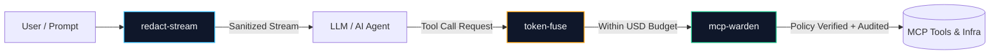

  <h2>Yoshi Kinga</h2>
  
<strong>Deterministic Security, Cost Circuit-Breakers & Privacy Guardrails for Production AI Agents</strong>

  

    
    
    
    
    
  

---

### Engineering Philosophy

Autonomous AI agents and **Model Context Protocol (MCP)** servers introduce non-deterministic operational risks: runaway API spend, sensitive data exfiltration across streaming chunks, and unauthorized tool execution. 

I design **zero-dependency, sub-millisecond TypeScript primitives** that sit between LLMs and critical infrastructure—giving engineering teams deterministic safety guarantees without supply-chain bloat or vendor lock-in.

---

### Production Safety Architecture

### Core Open-Source Suite

| Package | Focus | Key Guarantee |
| :--- | :--- | :--- |
| **[`mcp-warden`](https://github.com/yoshikinga/mcp-warden)** | **MCP Firewall & Audit** | JSON-RPC tool-call policy enforcement, path-traversal blocking & SHA-256 audit logs. |
| **[`token-fuse`](https://github.com/yoshikinga/token-fuse)** | **FinOps Circuit-Breaker** | Real-time USD spend caps & semantic infinite-loop termination in `< 1ms`. |
| **[`redact-stream`](https://github.com/yoshikinga/redact-stream)** | **Streaming PII Scrubber** | Chunk-boundary aware API key, JWT & PII redaction with reversible local tokens. |

---

### Technical Standards & Runtime Stack

  
  
  
  
  
  

* **Zero External Runtime Dependencies:** `0` third-party `npm` packages in production builds—eliminating transitive CVE risks.
* **Universal Edge Compatibility:** Pure Web Standard APIs (`ReadableStream`, `TransformStream`, `crypto.subtle`) running identically across Node.js, Bun, Deno, and Serverless Edge runtimes.
* **Deterministic Latency:** Engineered for inline request pipelines with strict memory bounds and zero regex catastrophic backtracking.

---

### Sustaining Independent Security Infrastructure

All libraries in this ecosystem are MIT-licensed, vendor-neutral, and maintained independently. If these guardrails protect your production API budgets, customer privacy, or MCP toolchains, consider backing ongoing development and security maintenance.

  

